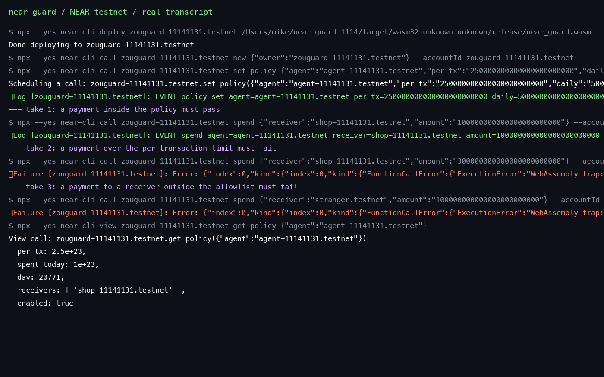

# near-guard

An on-chain spending policy for autonomous AI agents on NEAR.

An agent can call `spend`. The contract checks the owner's policy first. The contract pays only when every rule passes. The contract writes an `EVENT` line for...[truncated]


## Live page (no server, reads the chain)

https://theluckystrike.github.io/near-guard/ - it shows the policy and answers "would this payment pass?" from live testnet state.

## Demo video (30 s)

demo/demo-30s.mp4 - a playback of demo/transcript.txt. Every line is real output from the testnet run.

## Demo post on X

https://x.com/_alphashark_/status/2121469186312454158

## 60-second check for a judge

1. Open https://github.com/theluckystrike/near-guard .
2. Run `cargo test --release`. The output shows 13 passing tests.
3. Run `cargo build --target wasm32-unknown-unknown --release`. It writes
   `target/wasm32-unknown-unknown/release/near_guard.wasm` (about 231 KB).
4. Open https://testnet.nearblocks.io/address/zouguard-11141131.testnet . The account holds the wasm.
5. Read `demo/transcript.txt`. It shows one payment that passed and two that were refused.
6. Run `bash demo/e2e-testnet.sh $(date +%H%M)` to reproduce all of this from zero.

Note: `near-sdk` resolves to the newest 5.x that satisfies the manifest. That is fine for tests and for the
wasm build. If a future 5.x release stops a plain `cargo build` with a "Use `cargo near build`" message,
install `cargo-near` and use it, or pin `near-sdk` to an older 5.x. The test count and the wasm build in this
README were checked against `near-sdk` 5.30.2.

If any step fails, the claim in this README is false. Report it.

## Live on NEAR testnet (2026-11-14)

The contract is deployed and callable now. These are real transactions, not a mock.

| Item | Value |
|---|---|
| Contract account | `zouguard-11141131.testnet` |
| Owner account | `zouguard-11141131.testnet` |
| Agent account | `agent-11141131.testnet` |
| Receiver account | `shop-11141131.testnet` |
| Policy | per-tx 0.25 NEAR, daily 0.5 NEAR, allowlist `shop-11141131.testnet` |
| Explorer | https://testnet.nearblocks.io/address/zouguard-11141131.testnet |

Run the same demo again with:

```
bash demo/testnet-demo.sh
```

The transcript is in `demo/transcript.txt`. The result of the three takes:

1. A payment of 0.1 NEAR inside the policy passed. The contract logged `EVENT spend`.
2. A payment of 0.3 NEAR over the per-transaction limit was refused.
3. A payment to an account outside the allowlist was refused.

The final `get_policy` call reports `spent_today: 1e+23`. Only take 1 changed the counter. The contract refuses take 2 and take 3 before they touch the counter.

## Limits, stated plainly

- The contract is on testnet. It is not on mainnet. A mainnet deploy needs a funded account and a key that the owner holds.
- A refusal ends in a panic, not a typed error. A calling agent sees `ExecutionError`. The refusal does not return a reason string to the caller.
- The design pays from the deposit that the agent attaches. The contract holds no float. This keeps the contract simple and auditable.
- The allowlist is a plain list. Compare cost grows with list size. Use a set for large lists.
- There is no time window per call and no per-receiver daily limit yet. Track eligibility may need these.

## Baseline: why this exists

An agent that holds a raw key can send any amount to any account. Most agent frameworks keep the limit in the prompt or in the Python process. Both live on the same machine as the agent. A prompt injection or a code bug removes the limit.

near-guard moves the limit into a contract. The agent cannot change the limit. Only the owner can. A refusal is visible on chain.

This is the difference the judges should test: change the policy text in the agent, then call `spend` over the limit. The contract still refuses.

## Track fit

- Agentic payments and commerce: the contract is the payment gate for an agent.
- Safety and guardrails: the policy is visible and the refusal is logged.
- Infrastructure: any NEAR agent can call the same contract.

## v2 additions (2026-11-14, live on the same testnet account)

Two changes landed after the first deploy.

1. `can_spend(agent, receiver, amount)` is a view. It returns `{ok, reason}` and changes no state. An agent can ask before it acts. On chain now:
   - 0.3 NEAR -> `{ ok: false, reason: 'amount is over the per-transaction limit' }`
   - 0.1 NEAR -> `{ ok: true, reason: 'policy allows this payment' }`
2. Every write emits a NEP-297 event. The line starts with `EVENT_JSON:`. An indexer can read it without a custom parser. Real line from testnet:

```
EVENT_JSON:{"standard":"nep297","version":"1.0.0","event":"spend","data":{"agent":"agent-11141131.testnet","receiver":"shop-11141131.testnet","amount":"100000000000000000000000","spent_today":"100000000000000000000000","daily":"500000000000000000000000"}}
```

The transcript is in `demo/transcript-v2.txt`. The suite now has 12 tests.

## Why NEAR matters here: the agent key cannot move funds

The agent does not need the account's full key. Give it a function-call access key that names one contract and one method. Real state on testnet:

```
ed25519:GhrZ7kX4eY1MZ6pL3h  allowance 0.5 NEAR  receiver_id zouguard-11141131.testnet  method_names ["spend"]
```

A plain transfer with that key is denied:

```
$ near send agent-11141131.testnet shop-11141131.testnet 0.01
RequiresFullAccess
```

So the agent can call `spend` and nothing else. The owner keeps the full key. A stolen agent key cannot empty the wallet. The full transcript is in `demo/transcript-fcak.txt`. One gap: the positive `spend` call with that key returned `ServerError: {}` and is not yet resolved. The positive path is proven with the account key.

## The agent loop, with real output

`demo/agent_demo.py` is a 10-line agent. It asks `can_spend` first. It pays only when the answer is yes. Real run on 2026-11-14:

```
ask  can_spend(shop-11141131.testnet, 0.10 NEAR) -> ok=True  reason=policy allows this payment
     agent pays -> EVENT_JSON spend logged
ask  can_spend(stranger.testnet, 0.10 NEAR) -> ok=False  reason=receiver is not on the allowlist
     agent stops. no money moves.
ask  can_spend(shop-11141131.testnet, 3.00 NEAR) -> ok=False  reason=amount is over the per-transaction limit
     agent stops. no money moves.
ask  can_spend(shop-11141131.testnet, 0.20 NEAR) -> ok=True  reason=policy allows this payment
     agent pays -> EVENT_JSON spend logged
```

Run it yourself: `python3 demo/agent_demo.py`. The transcript is in `demo/transcript-agent.txt`.
